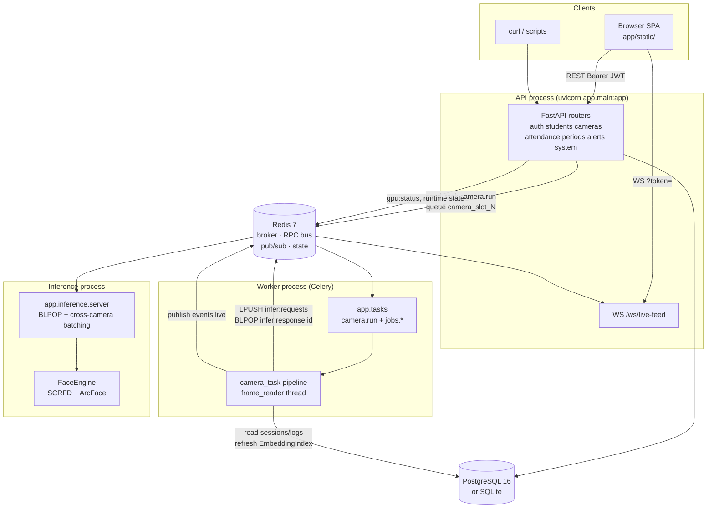
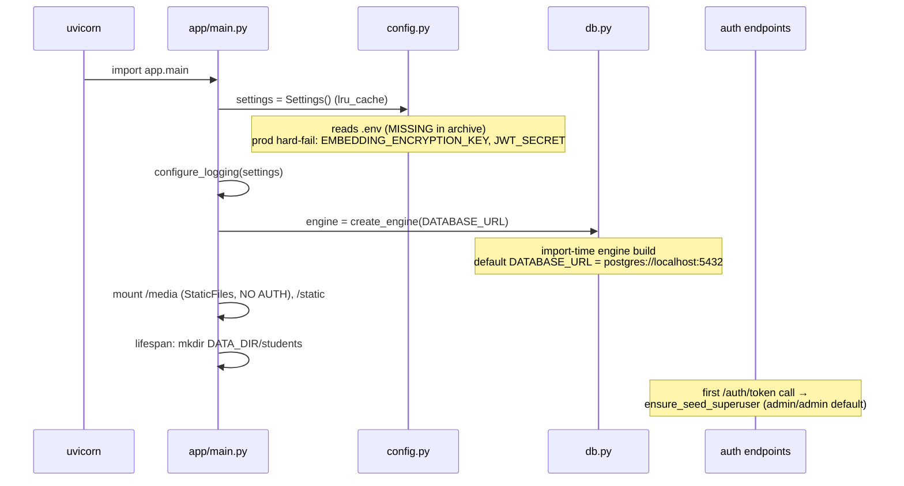
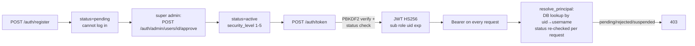
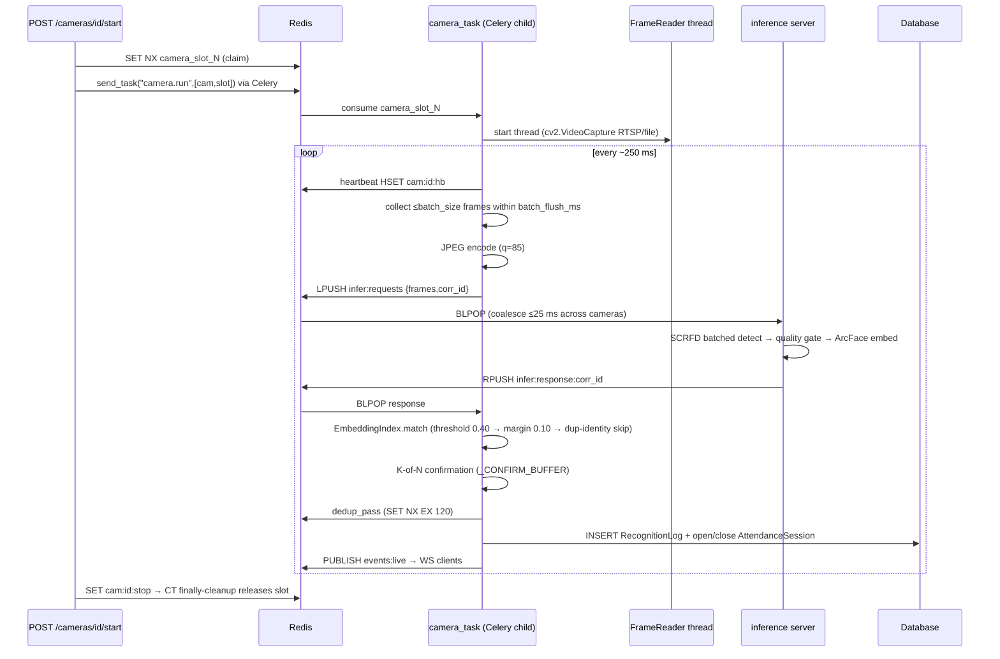
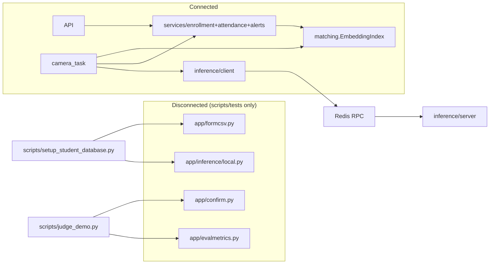

# 04 — Architecture and Data Flow

All flows below were verified against actual code (file:line references), not documentation.

## 1. High-level system architecture

Key property (verified): the **API process never loads cv2/onnxruntime/insightface** — heavy imports are function-local in `engine.py`, `frame_reader.py`, `server.py`; the API talks to inference only through Redis RPC (`inference/client.py` imports only `redis`).

## 2. Application startup

Migrations are **not** run by the API process itself; compose runs `alembic upgrade head` in the api container command (`docker-compose.yml:64`). The worker and inference processes never migrate.

## 3. Frontend navigation and rendering

Vanilla SPA, no framework. `boot()` (`app.js:187-199`): token in `localStorage` → `enterApp()`; else probe `GET /students?limit=1` to detect `AUTH_REQUIRED=false`. `enterApp()` loads `/auth/me` (role gates the Users nav), fetches all dashboard data, opens the WebSocket. Sections toggle via `hidden` attribute; tables re-fetch on section entry. Live section polls `/attendance/live` every 5 s (`liveTimer`) and prepends WS events (cap 60).

## 4. Registration and authentication

Password reset is **manual, in-app**: `POST /auth/forgot-password` writes a `PasswordResetRequest`; only the super admin sets a new password (`POST /auth/admin/password-requests/{id}`). No email/SMS integration exists. While the seeded super admin's `password_source=="env"`, the `.env` `ADMIN_PASSWORD` acts as a perpetual alternate credential (re-syncing the hash) — deliberate, documented (`users.py:213-226`).

## 5. Camera pipeline (the core real-time flow)

Maintenance (Celery beat): `jobs.close_stale_sessions` (daily), `jobs.check_period_deviations` (5 min → alerts), `jobs.reap_dead_cameras` (1 min, reclaims expired heartbeats/slots).

## 6. Enrollment flow

`POST /students` (multipart) → `enrollment.enroll_student`:
1. photo-count gate (3-5) + registration_no regex;
2. per photo: `quality.check_photo_quality` → RPC `infer_frames` (exactly one face, det score ≥0.6, width ≥80 px, pose ≤30°); sharpness/brightness enforced only inside the engine's `_quality_ok`;
3. RPC `embed_images` → 512-d vectors;
4. `quality.check_duplicate_face` vs every existing student (cosine ≥ `recognition_threshold` **0.40** — see inconsistency note in 05);
5. encrypt embeddings (`crypto.encrypt_embeddings`, Fernet) → `students.embeddings`; save photos under `DATA_DIR/students/<reg>/`;
6. `bump_students_version()` → all live `EmbeddingIndex` instances refresh lazily.

## 7. Integration boundaries and disconnected parts

- `app/confirm.py` reimplements the live pipeline's confirmation with **different constants** (3 frames/10 s vs `config.confirmation_frames=2`/5 s) and per-track semantics vs the live per-(camera,student) semantics.
- `INFERENCE_MODE=inprocess` is **documented** as a worker debug mode but nothing in `app/tasks.py`, `camera_task.py`, or worker startup ever installs `LocalInference` — only scripts call `.install()`. The flag currently affects only what `/system/*` reports.
- `app/formcsv.py` (Google-Forms pipeline) is not reachable from any HTTP route; the live bulk import uses a *different* CSV schema via `services/enrollment.bulk_enroll_from_csv`.

## 8. Error handling and response delivery

- Global catch-all: `app/main.py:125-133` logs with traceback and returns `500 {"detail":"internal server error"}`.
- Domain errors: `EnrollmentError` → mapped status (`students.py:50-51`); `InferenceUnavailable`/`InferenceError` → 503; Redis down → 503 on camera control, degraded health, silent dedup/version fallbacks.
- Camera pipeline: **no per-iteration try/except** — one DB failure terminates the whole camera task (`camera_task.py:380-384`); cleanup in `finally` keeps Redis state consistent.
- Inference service: CPU fallback with retry on CUDA faults (`server.py:263-279`); stale requests dropped after `inference_request_timeout_s`.
- Frontend: 401 → auto-logout toast; 403 → error toast; per-card dashboard soft-fail to "?"; live-poll errors silenced to console (deliberate).

## 9. Module dependency notes

- No circular imports found by inspection (the "late import to avoid circular" comments in `services/attendance.py:110,134,203` are unnecessary — models never import services).
- `app/tasks.py` is loaded **only** by Celery `include=["app.tasks"]` (`celery_app.py:24`); the API dispatches `camera.run` by name string, so API and worker are import-decoupled (verified).
- `app/crypto.py` computes its Fernet instance **at import time** (100k-iteration PBKDF2), so every process importing `app.models` pays it once.
